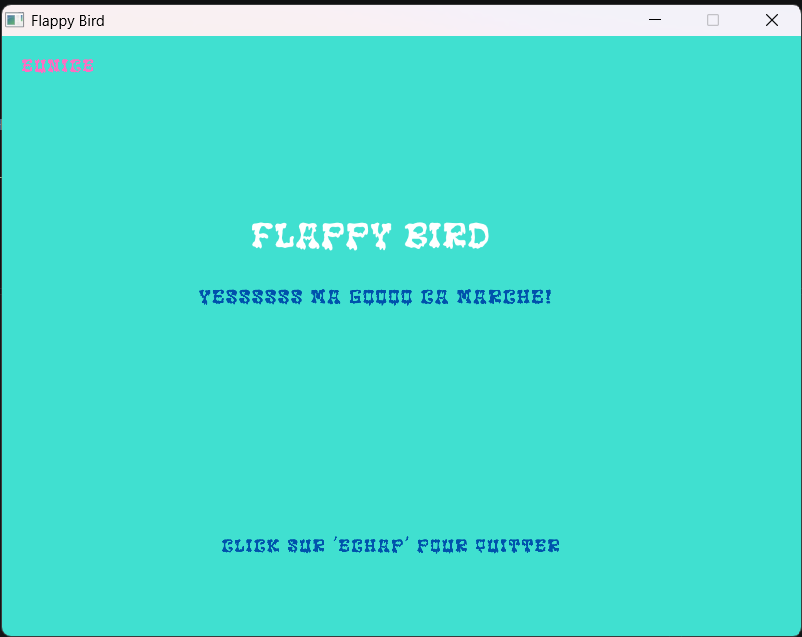
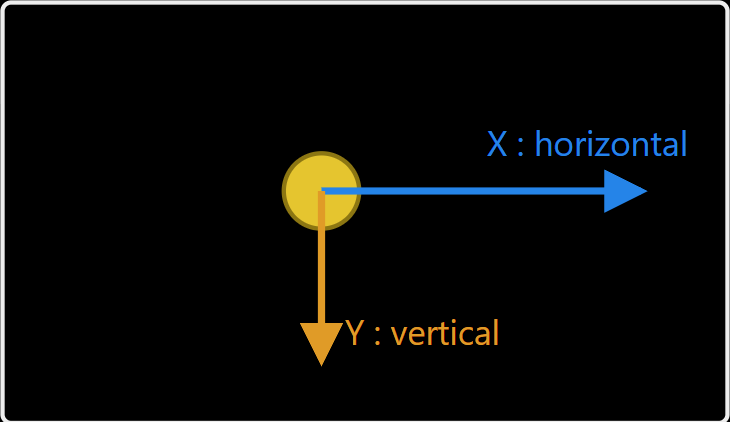
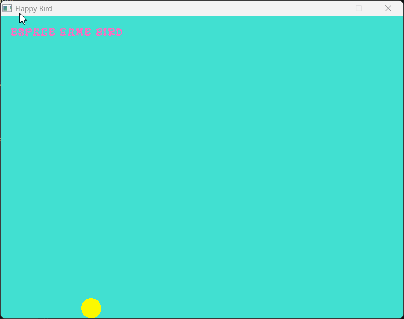

# Flappy_bird

commande compilation a pre modification
pour main simple
```
gcc src/main.c -o flappy_bird.exe -lraylib -lopengl32 -lgdi32 -lwinmm
```
pour main.c et bird.c
```
gcc src/main.c src/bird.c -o flappy.exe $(pkg-config --cflags --libs raylib) -lopengl32 -lgdi32 -lwinmm
```
```
./flappy.exe
```
Gestion fenêtres sur une interface graphique (GUI)


Gestion gravite de l'oiseau


Gestion deplacement Horizontal de l'oiseau



## Démonstration

