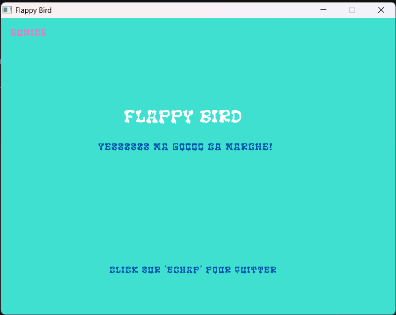
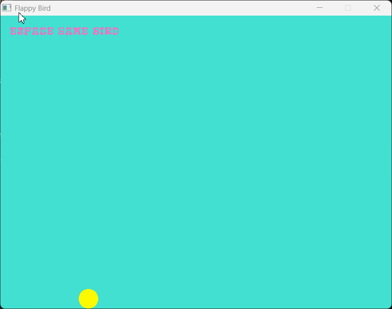
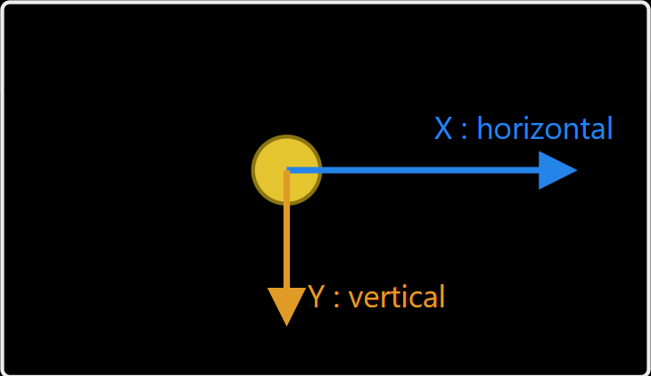
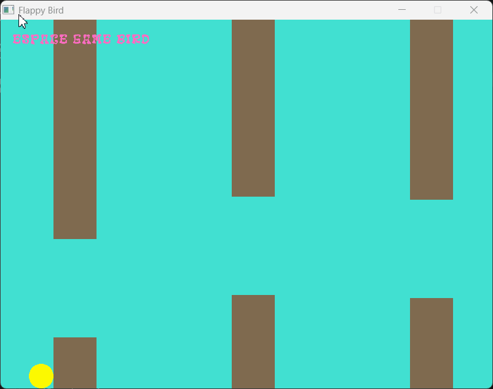
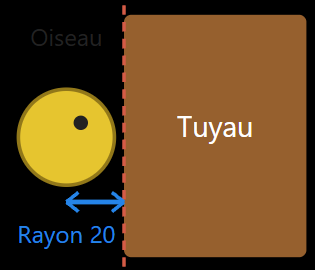
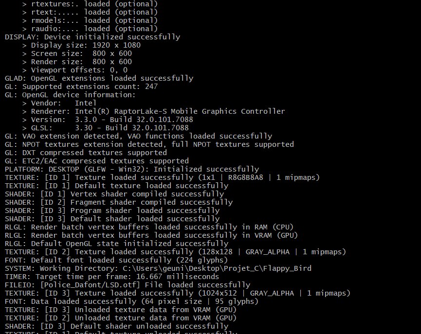
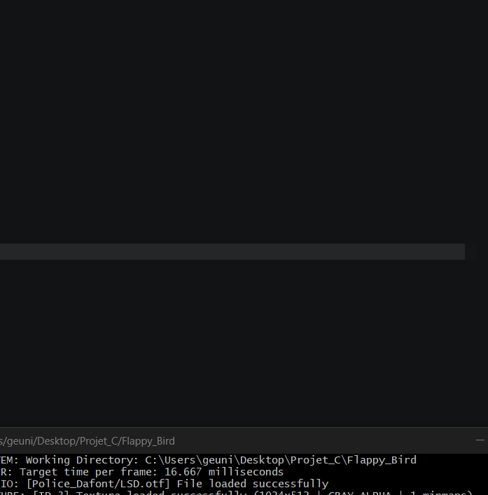

# Flappy_bird

### Les commande compilation  et les demontraction 

pour mise a jour du code 
```
gcc src/main.c src/bird.c src/pipes.c src/game.c src/blocs.c src/fleches.c -o flappy.exe $(pkg-config --cflags --libs raylib) -lopengl32 -lgdi32 -lwinmm
```
 lancement du jeux
```
./flappy.exe
```
- Gestion fenêtres sur une interface graphique (GUI)



## Démonstration
- Gestion gravite et deplacement Horizontal de l'oiseau




- Gestion tuyeau, l'oiseau est replacé à gauche du tuyau





- Gestion des niveaux, changement de décor et ajout du chronomètre



- Création du niveau 3 avec 3 flèches, changement de décor pour le niveau extrême, déplacements horizontaux et verticaux des obstacles


